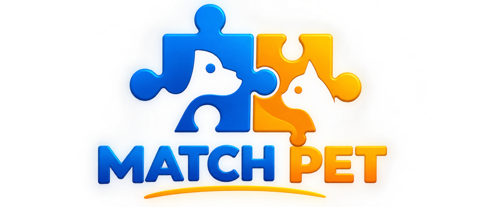
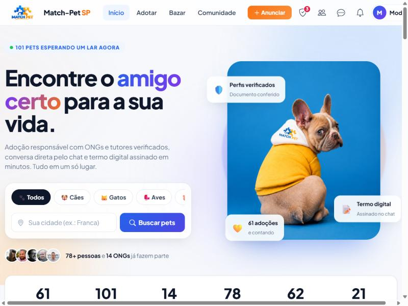
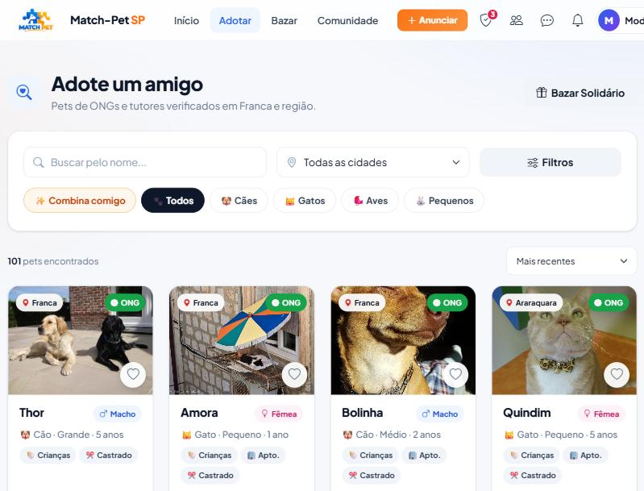
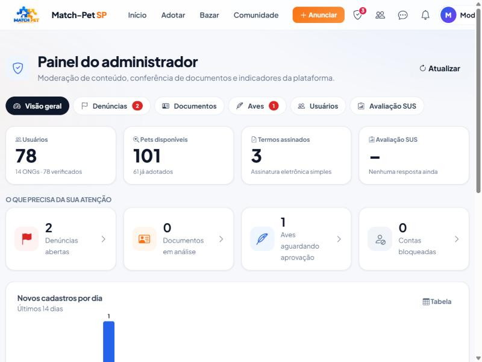
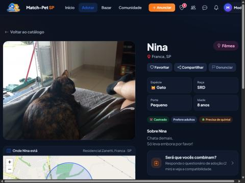

<div align="center">



# Match-Pet SP

**Plataforma web para adoção e doação segura de animais em Franca/SP e região**

[](https://github.com/otaviosantosfrancelino-code/matchpet/actions/workflows/testes.yml)


### 🌐 [matchpet.onrender.com](https://matchpet.onrender.com)

Trabalho de Conclusão de Curso apresentado no **3º CODITEC**
Otávio Miguel Santos Francelino · Pedro Henrique Palamoni Grace

</div>

---

## Sobre o projeto

No Brasil, cerca de **4,8 milhões de cães e gatos** vivem em situação de vulnerabilidade (Instituto Pet Brasil, 2024). Boa parte das adoções ainda é feita em grupos de redes sociais, que não filtram os animais pela realidade do adotante, não verificam quem doa ou adota e expõem telefone e endereço a desconhecidos.

O **Match-Pet** conecta adotantes, protetores e ONGs e torna a adoção:

| | |
|---|---|
| 🧩 **Compatível** | O catálogo cruza a moradia e a família do adotante com as necessidades do pet. Um questionário de adoção calcula a compatibilidade em porcentagem. |
| 🛡️ **Segura** | A identidade é verificada com IA (leitura do documento comparada ao cadastro). O chat é interno, sem expor o telefone. Há denúncias e moderação. |
| 📄 **Rastreável** | O termo de adoção eletrônico registra data, hora e IP das duas partes, com código de autenticidade, QR code e verificação pública. |

<p align="center">
  
  
</p>
<p align="center">
  
  
</p>

## Funcionalidades

**Adoção**
- Catálogo com filtros de espécie, porte, sexo, idade, raça, cidade, castração e "só ONGs", mais o filtro **✨ Combina comigo**, que usa o questionário do adotante
- **Questionário de adoção responsável** (moradia, rotina, família, custos). O doador vê as respostas e a % de compatibilidade dentro do chat
- Página do pet com galeria, mapa da **região aproximada** (nunca o endereço) e quadro de compatibilidade
- **Favoritos** ❤️, e compartilhamento no WhatsApp/Facebook com prévia (foto e nome do pet)
- Chat em tempo real (SignalR) com envio de fotos
- **Termo de adoção eletrônico**: assinatura eletrônica simples (Lei 14.063/2020), código `MP-XXXX-XXXX`, QR code, impressão digital SHA-256 e página pública [`/verificar-termo`](https://matchpet.onrender.com/verificar-termo)
- Acompanhamento pós-adoção automático (lembretes com 7 e 30 dias)

**Comunidade**
- Feed com fotos e vídeos, patinhas (curtidas), comentários, amizades e vídeos em tela cheia
- Galeria **Final Feliz**, **Bazar Solidário** de itens, página de ONGs com Pix
- Estatísticas e rankings (adoções por cidade, espécie, porte e mês)

**Segurança, moderação e LGPD**
- **Painel do administrador** (`/admin`): denúncias, conferência manual de documentos, aprovação de aves, bloqueio de contas e indicadores
- **Denúncias** em pets, itens, publicações e perfis (maus-tratos, venda, animal silvestre, golpe...)
- **RN04, só animais domésticos** (Portaria Ibama nº 93/1998). Aves passam por moderação prévia
- Foto do documento **criptografada** (AES-256 + HMAC via ASP.NET Data Protection) e **apagada** depois da conferência. Fica só o hash SHA-256, contra fraudes
- Senhas com hash PBKDF2, limite de tentativas de login, limite de requisições na API, cabeçalhos de segurança (CSP, HSTS, X-Frame-Options)
- Senha do banco fora do código (variáveis de ambiente / *user-secrets*)
- [Política de Privacidade e Termos de Uso](https://matchpet.onrender.com/privacidade)

**Experiência**
- Responsivo, com barra de navegação inferior no celular
- **Aplicativo instalável (PWA)** com tela de "sem internet"
- **Modo escuro** que segue o sistema ou a escolha do usuário
- Acessibilidade: link "pular para o conteúdo", foco visível, rótulos ARIA e respeito a "reduzir movimento"
- **Avaliação de usabilidade com o questionário SUS** (System Usability Scale) em [`/avaliar`](https://matchpet.onrender.com/avaliar), com resultados no painel

## Regras de negócio

| ID | Regra |
|---|---|
| RN01 | Um único cadastro por CPF ou CNPJ, com validação dos dígitos e consulta do CNPJ |
| RN02 | Só usuários com documento verificado enviam ou assinam o termo de adoção |
| RN03 | O selo "Usuário/ONG Verificada" depende da verificação do documento |
| RN04 | Só animais domésticos; anúncios de aves passam por moderação |
| RN05 | Telefone e endereço do doador não são exibidos; o contato é pelo chat |
| RN06 | Todo termo assinado gera registro permanente com data, hora, IP e código |

## Arquitetura

```
┌──────────────────────────────────────────────────────────────┐
│  Apresentação   Componentes Blazor (Razor) · Bootstrap 5 · JS │
├──────────────────────────────────────────────────────────────┤
│  Serviços       Auth · Chat · Termos · Validação com IA ·     │
│                 Moderação · Favoritos · Questionários · SUS   │
├──────────────────────────────────────────────────────────────┤
│  Repositórios   Entity Framework Core 9                       │
├──────────────────────────────────────────────────────────────┤
│  Banco          PostgreSQL (Neon) · Docker no Render          │
└──────────────────────────────────────────────────────────────┘
```

```
Components/   telas (Pages), layout e componentes reutilizáveis (Shared)
Services/     regras de negócio (RegrasAdocao.cs reúne as regras puras e testáveis)
Repositories/ acesso ao banco
Models/       entidades (Usuario, Pet, TermoAdocao, Denuncia, PerfilAdotante...)
Data/         contexto do EF Core e dados de demonstração
Migrations/   histórico versionado do banco
Endpoints/    imagens, compartilhamento (/p/{id}) e sitemap
tests/        testes automatizados (xUnit)
```

**Tecnologias:** C# · .NET 9 · ASP.NET Core Blazor Server · SignalR · Entity Framework Core 9 · PostgreSQL (Neon) · Docker · Render · Bootstrap 5 · Leaflet + OpenStreetMap · Claude (IA com visão) · BrasilAPI · ViaCEP · xUnit · GitHub Actions

## Testes automatizados

```bash
dotnet test tests/crudcomdb.Tests
```

São **59 testes** que cobrem validação de CPF/CNPJ, hash de senha, limite de tentativas, criptografia do documento, espécies permitidas, cálculo de compatibilidade, pontuação SUS e autenticidade do termo. Eles rodam automaticamente no GitHub Actions a cada envio.

## Como rodar no computador

Pré-requisitos: [.NET 9 SDK](https://dotnet.microsoft.com/download) e um banco PostgreSQL.

```bash
git clone https://github.com/otaviosantosfrancelino-code/matchpet.git
cd matchpet
dotnet user-secrets set "ConnectionStrings:DefaultConnection" "Host=...;Database=...;Username=...;Password=..."
dotnet run
```

As migrações e os dados de demonstração são aplicados automaticamente na primeira execução. Em modo de desenvolvimento, o site também cria três contas para a apresentação (administrador, adotante e ONG), com senhas aleatórias gravadas no arquivo local `CONTAS_BANCA.local.txt`, que nunca vai para o GitHub.

### Configurações (variáveis de ambiente)

| Variável | Para quê |
|---|---|
| `ConnectionStrings__DefaultConnection` | Conexão com o PostgreSQL (obrigatória) |
| `Admin__Emails` | E-mails que viram administradores, separados por `;` |
| `ANTHROPIC_API_KEY` | Leitura automática do documento com IA (opcional) |
| `Email__Provedor`, `Email__BrevoApiKey`, `Email__RemetenteEmail`... | Envio dos e-mails de recuperação de senha (opcional) |

O passo a passo de publicação está em [GUIA_PUBLICACAO.md](GUIA_PUBLICACAO.md).

## Aviso

Os números exibidos no site (adoções, pessoas e ONGs) incluem **cadastros de demonstração** criados para a apresentação e não representam resultados reais de uso.

---

<div align="center">Feito com 🐾 em Franca/SP · 2026</div>
